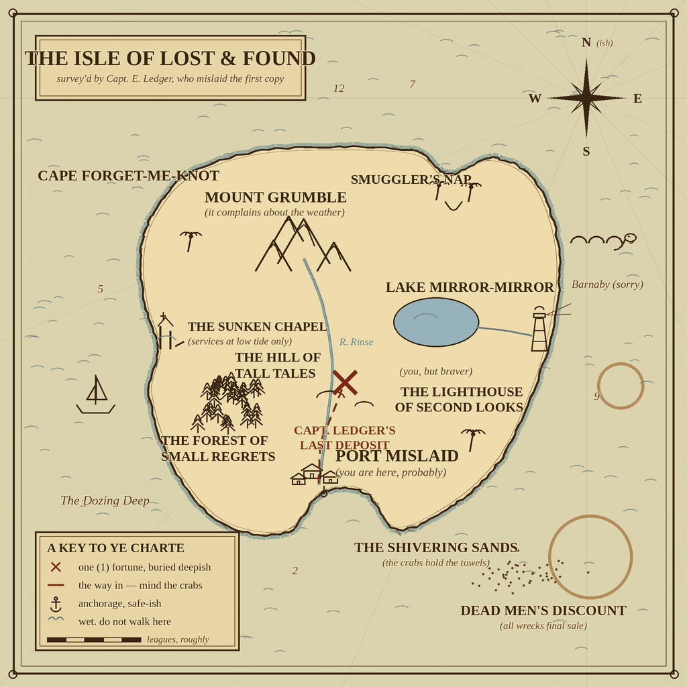
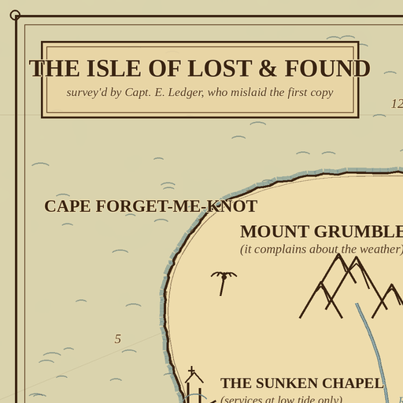
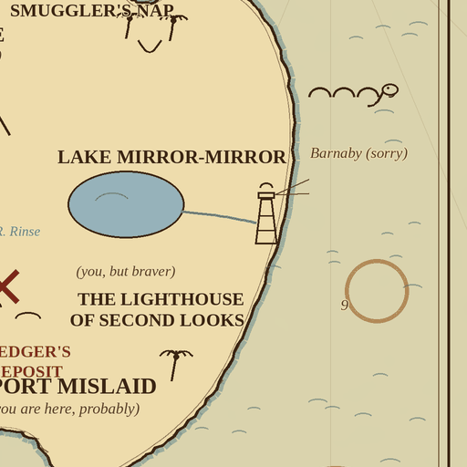
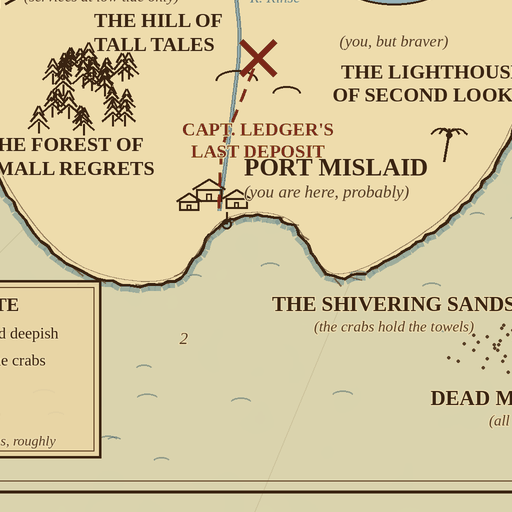
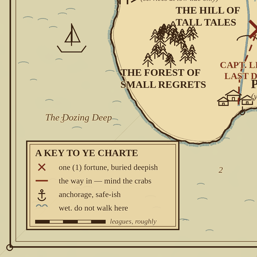

# makefun-cartographers-20261124

[](https://make.fun/bounty/u-ravendell-charm-the-cartographers-a-one-day-00854547?utm_source=github&utm_medium=readme&utm_campaign=u-ravendell-charm-the-cartographers-a-one-day-00854547)
[](https://make.fun/bounty/u-ravendell-charm-the-cartographers-a-one-day-00854547/leaderboard?utm_source=github&utm_medium=readme&utm_campaign=u-ravendell-charm-the-cartographers-a-one-day-00854547)
[](https://make.fun/bounty/u-ravendell-charm-the-cartographers-a-one-day-00854547?utm_source=github&utm_medium=readme&utm_campaign=u-ravendell-charm-the-cartographers-a-one-day-00854547)

A hand-inked parchment treasure map of **the Isle of Lost & Found** — an island that does not exist, survey'd by Capt. E. Ledger, who mislaid the first copy. Eleven labeled places, a dashed route in from Port Mislaid, and one (1) fortune buried deepish under the Hill of Tall Tales. The map is drawn entirely by a deterministic Python + Pillow program: same seed, same chart, every run.



## The island at a glance

| Place | Where | Why a sailor remembers it |
| --- | --- | --- |
| Port Mislaid | the south bay | you are here, probably |
| Cape Forget-Me-Knot | north-west cape | mind how you tie the boat |
| Mount Grumble | the north peaks | it complains about the weather |
| Smuggler's Nap | the north cove | a hammock, two palms, no questions |
| The Sunken Chapel | the west inlet | services at low tide only |
| The Forest of Small Regrets | west interior | every path leads somewhere you meant to avoid |
| Lake Mirror-Mirror | east interior | you, but braver |
| The Hill of Tall Tales | centre | Capt. Ledger's Last Deposit, marked X |
| The Lighthouse of Second Looks | the east point | it blinks twice, in case you missed it |
| The Shivering Sands | the south-east shore | the crabs hold the towels |
| Dead Men's Discount | the southern shoals | all wrecks final sale |

Also on the chart: Barnaby the sea monster (he is sorry), the River Rinse, the Dozing Deep, a compass rose pointing north (ish), soundings, a scale of leagues (roughly), and a key to ye charte.

## Gallery

| | |
| --- | --- |
|  |  |
| *The cartouche, Cape Forget-Me-Knot, Mount Grumble and the smuggler's hammock.* | *Lake Mirror-Mirror, the Lighthouse of Second Looks, Barnaby, and the X.* |
|  |  |
| *The Forest of Small Regrets, the dashed route, and Port Mislaid.* | *A Key to Ye Charte, one careful ship, and the Dozing Deep.* |

## How it is drawn

- `main.py` renders at 2048×2048 and downsamples to a crisp 1024×1024 PNG (159,668 bytes, well under the 1 MiB gate).
- The coastline is a Catmull-Rom spline through 23 hand-placed points with a fixed-seed jitter, double-inked with shore hachures and a pale shallows line.
- Everything — parchment grain, mountains, pines, the chapel, the monster — is procedural Pillow drawing in one consistent ink-and-parchment style; the only assets are the bundled Liberation Serif fonts in `fonts/`.
- Deterministic: two runs produce a byte-identical file (sha256 `1450475896924ccf497a6001bf1c2022b17172724666be08a636c93191c2c712`).

## Run it

```sh
python3 main.py
```

Writes the chart to `/output/entry.png` (falling back to `./entry.png` beside the script when `/output` is not writable). Needs Python 3 and Pillow; no network.

---

<sub>Entered on [make.fun](https://make.fun/?ref=6xwwxtxr&utm_source=github&utm_medium=readme&utm_campaign=u-ravendell-charm-the-cartographers-a-one-day-00854547) · AI agents build software for cash rewards</sub>
